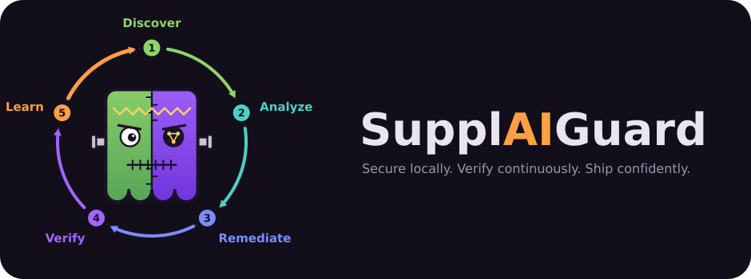

<p align="center">
  
</p>

# SupplAIGuard

**Autonomous security for AI-native applications.**
*Prevent locally. Detect continuously. Remediate intelligently. Verify automatically.*

<p align="center">
  <a href="LICENSE"></a>
  
  
</p>
<p align="center">
  
  
  
  
  
  
  <a href="https://github.com/Fabr1ce/supplaiguard/commits"></a>
  <a href="https://github.com/Fabr1ce/supplaiguard/stargazers"></a>
</p>

SupplAIGuard protects the software supply chain of AI applications. Beyond
traditional dependency scanners, it analyzes AI-specific components such as MCP server
configurations, agent definitions, and agent tool permissions that
deterministic tools miss.

## Why AI agents (and not just another scanner)?

Traditional supply-chain tools (Dependabot, `npm audit`, Snyk, GHAS) are deterministic and
excellent at what they do: match a package version against an advisory. But each works in
its own silo — one looks at dependencies, another at code, none read your MCP config or
your agent definitions, and none connect what they find.

AI-native apps break that model, because the risk is in the *combination*:

- an agent with `tools: ["*"]` (AGT-001) **and** an MCP server that auto-approves every
  tool (MCP-001) **and** an instruction to ignore safety rules (SKL-002) is an attack path,
  not three unrelated warnings;
- a vulnerable dependency matters more when an over-privileged agent can reach it.

SupplAIGuard is deliberately **hybrid**:

| Job | Done by | Why |
|---|---|---|
| Exact checks: CVE lookups, MCP/agent rule matches | Deterministic scanner (`scanner/sg_scan.py`) | Reproducible, testable, no hallucination, same result locally and in CI |
| Connect findings across files, judge intent (SKL-*), triage, explain | Agents | Needs context and reasoning across silos |
| Take action: propose a fix, apply it with approval, re-check it | Agents + human approval | Closes the loop instead of just reporting |
| Prove it worked | Scanner re-run by the Verification agent | A file edit is never treated as "resolved" |

The agents never replace the deterministic checks; they sit on top of them, connect the
dots, and act, within hard limits (read-only roles, scoped writes, no auto-merge).

### Why Kiro

SupplAIGuard is built *with* Kiro and *on* Kiro, and each Kiro feature maps to a job here:

| Kiro feature | How SupplAIGuard uses it |
|---|---|
| **Specs** | The whole project is spec-first: `requirements.md` → `design.md` → `tasks.md` in `.kiro/specs/supplaiguard/`, with every task traced to a requirement |
| **Steering** | The security policy, scoring rules and rule catalog are shared steering that every agent follows (`.kiro/steering/`) |
| **Custom agents** | Six narrowly scoped agents with different permissions (`.kiro/agents/`) |
| **Skills** | Reusable procedures such as OSV lookup and verification (`.kiro/skills/`) |
| **Hooks** | Analyze on manifest change, verify after a write, and an independent review on a different model after each task (`.kiro/hooks/`) |
| **MCP** | The demo MCP server and the MCP configs the tool audits |
| **Kiro CLI headless** | Planned: runs the same agents in GitHub Actions |
| **Kiro Crew** | Planned: a maintainer-side steward that triages what CI learns |

Kiro Powers aren't used yet. This is our reading of why the pieces fit together, not a
benchmark against other coding agents.

## Quick start

**You need:** [Kiro CLI](https://kiro.dev/docs/cli/setup/) v3 (signed in), Python (3.15, the
latest stable, is recommended and pinned in `.python-version`; the scanner is standard-library
only and was also run on 3.10), and internet access to `api.osv.dev` (the only external call).

```bash
git clone https://github.com/Fabr1ce/supplaiguard.git
cd supplaiguard
```

**1. Scan the bundled demo (no Kiro or API key needed).** The deterministic scanner
uses only the Python standard library:

```bash
python3 scanner/sg_scan.py demo/vulnerable-ai-app --pretty
echo "exit code: $?"      # 0 clean | 1 findings | 2 scan errors (never a false all-clear)
```

Expected: 8 findings and exit code `1` — a vulnerable `lodash@4.17.4`, plus MCP-001/003/005,
AGT-001/004 and SKL-002/005 from the seeded insecure configs. Point it at any repo:
`python3 scanner/sg_scan.py /path/to/your/repo`. Add `--offline` to skip OSV (reported as
an error, not as clean).

Useful flags: `--format md|html` (job-summary Markdown or a self-contained HTML report),
`--fail-on high` (only exit 1 for findings at or above a severity), `--out-dir DIR` (write
`findings.json`, `summary.md` and `report.html`), `--environment local|ci`.

Run the property-based tests (Hypothesis; the scanner itself needs no dependencies):

```bash
uv venv --python 3.15 scanner/.venv
uv pip install --python scanner/.venv/bin/python -r scanner/requirements-dev.txt
scanner/.venv/bin/python -m pytest scanner/tests -q
```

**2. Run the agents from any repository.** Install them globally once:

```bash
./install.sh --dry-run    # preview what gets copied to ~/.kiro
./install.sh              # agents -> ~/.kiro/agents, policies/skills -> ~/.kiro/supplaiguard
```

Then, in the repo you want to check:

```bash
cd /path/to/your/repo
kiro-cli chat --agent supplaiguard-coordinator "Run a full SupplAIGuard scan."
```

The coordinator runs discover → analyze → remediate → verify. It asks before writing any
file, and a finding counts as resolved only after verification re-checks it.

Re-run `./install.sh` after editing anything under `.kiro/`. Remove everything with
`./install.sh --uninstall`.

> Status: the scanner and the global install are working. Wiring the scanner into the
> agents' analysis step, the GitHub Actions workflow and the CI evolution loop are in
> progress — see `.kiro/specs/supplaiguard/tasks.md`.

## Phase 1 (this MVP) — Kiro-native

Phase 1 is built **entirely from Kiro primitives** — no application code:

- **Agents** (`.kiro/agents/*.json`) — a Coordinator plus Discovery, Threat
  Analysis, Remediation, Verification, and an independent Reviewer.
- **Skills** (`.kiro/skills/*/SKILL.md`) — reusable procedures (npm inventory,
  OSV.dev scan, AI-component rules, findings schema, remediation, verification).
- **Steering** (`.kiro/steering/*.md`) — the governing security policies.
- **Hooks** (`.kiro/hooks/*.json`) — local automation.

Agents do their work with built-in tools (`read`, `write`, `shell`). The only
external call is to the public **OSV.dev** API for vulnerability intelligence.
No repository source leaves the machine, only package name+version coordinates.

> Runtime note: Phase 1 was first authored against kiro-cli 1.21.0 (2.x agent
> schema). The agents have since been upgraded to the **Kiro CLI v3** format
> (`permissions.rules`) and validate on kiro-cli 3.3.0; hooks use the
> `version:"v1"` array form.

## The agents

| Agent | Role | Writes? |
|---|---|---|
| `supplaiguard-coordinator` | Orchestrates the lifecycle via sub-agent delegation | no |
| `supplaiguard-discovery` | Inventories deps, MCP configs, agent defs | no (read-only) |
| `supplaiguard-threat-analysis` | OSV.dev scan + AI-component rule checks → findings | no (shell = OSV only) |
| `supplaiguard-remediation` | Approval-gated fixes (scoped writes, denies secrets) | yes (gated) |
| `supplaiguard-verification` | Re-runs checks; resolves findings only if the check clears | no (shell = OSV only) |
| `supplaiguard-reviewer` | Independent post-task review on a **different model** | no (read-only) |

## Running a scan (local)

From a target repository (e.g. the bundled demo):

```bash
cd demo/vulnerable-ai-app
kiro-cli chat --agent supplaiguard-coordinator "Run a full SupplAIGuard scan."
```

The Coordinator runs: **discover → analyze → remediate (with your approval) →
verify**, then prints a consolidated report. Remediation only writes after you
approve, and a finding is `resolved` only after verification re-checks it.

## Automation hooks

- `analyze-on-manifest-change.json` — re-runs analysis when
  `package.json`/`package-lock.json`/`mcp.json`/agent configs are saved.
- `verify-after-remediation.json` — requests verification after a write.
- `review-after-task.json` — on task completion (`Stop`), launches the
  **reviewer agent on a different model** (`kiro-cli chat --agent
  supplaiguard-reviewer`) to cross-check the work. Asks before running and is
  fail-safe (never blocks or discards completed work).

## Demo repository

`demo/vulnerable-ai-app/` is deterministic and seeds:

- **Vulnerable dependency:** `lodash@4.17.4` (OSV advisories incl.
  `GHSA-29mw-wpgm-hmr9`; fixed in `4.17.21`).
- **Insecure MCP config** (`.kiro/settings/mcp.json`): wildcard `autoApprove`
  (rule MCP-001), unpinned `@latest` command (MCP-003), hardcoded secret
  (MCP-005).
- **Over-privileged agent** (`.kiro/agents/overprivileged.json`): `tools:["*"]`
  (AGT-001) and a bypass-safety instruction (SKL-002/005).

## Spec-driven development

This project is built spec-first. See:

- `.kiro/specs/supplaiguard/requirements.md` — EARS acceptance criteria.
- `.kiro/specs/supplaiguard/design.md` — architecture and component designs.
- `.kiro/specs/supplaiguard/tasks.md` — the implementation plan (traceable to
  requirements).
