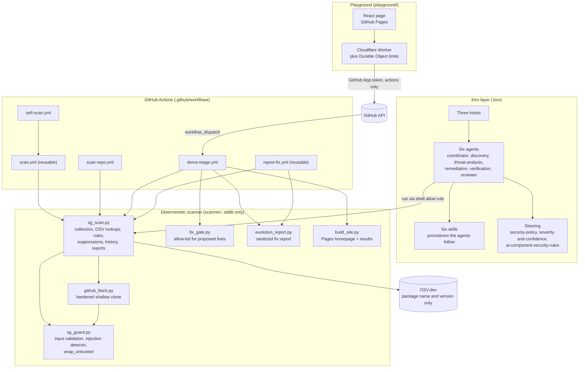
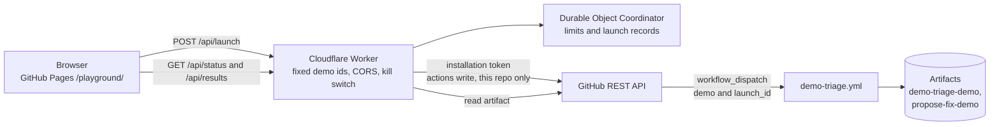
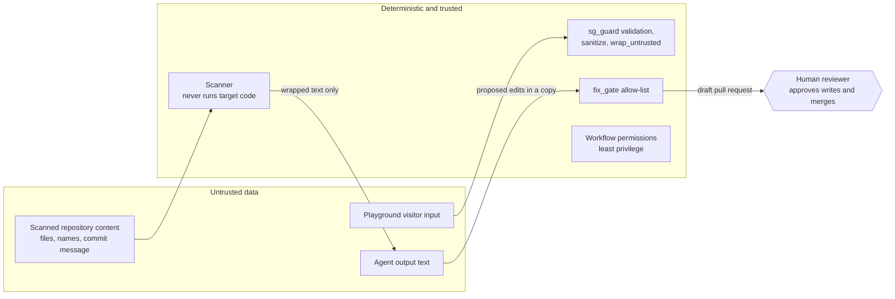

# Architecture

SupplAIGuard is a hybrid. A deterministic scanner makes the exact checks. Kiro agents add reasoning and action on top. GitHub workflows run the same scanner in CI. A Playground lets a visitor start a demo run.

## Components

### The Scanner

`scanner/sg_scan.py` uses only the Python standard library. In `run_scan` it walks the target and runs these collectors, each wrapped so that one odd file becomes a scan error and never a crash or a clean result:

| Input | Check | Findings |
|---|---|---|
| `mcp.json` | MCP rules MCP-001 to MCP-005 | `insecure_mcp_configuration` |
| `.kiro/agents/*.json` | Agent rules AGT-001 to AGT-004 | `excessive_tool_permissions` |
| `SKILL.md`, agent and MCP strings, README, CONTRIBUTING, top level `docs/*.md`, file names, HEAD commit message | Phrase rules SKL-001 to SKL-005 and the injection detector | `suspicious_agent_skill` |
| `package-lock.json`, `requirements*.txt` | OSV.dev batch query for every installed name and version | `vulnerable_dependency` |

The rule catalog is [`.kiro/steering/ai-component-security-rules.md`](../.kiro/steering/ai-component-security-rules.md). Scoring follows [`.kiro/steering/severity-and-confidence.md`](../.kiro/steering/severity-and-confidence.md).

Output is one scan object (`findings`, `errors`, `coverage`) rendered as text, JSON, Markdown or HTML. With `--out-dir` it writes `findings.json`, `summary.md` and `report.html`. Exit codes: `0` clean, `1` findings at or above `--fail-on`, `2` scan errors. An error is never reported as clean.

Other scanner features:

- **Suppressions** (`--suppressions FILE`): each entry needs a reason and a rule plus a file, and may expire. Suppressed findings still appear in every report. A broken file exits 2.
- **Learn** (`--history`, `--learn-report`): appends an allow-listed record to `.supplaiguard/history.jsonl`. See [Flow](flow.md#learn).
- **GitHub targets** (`--github owner/name`, `--ref`): `scanner/github_fetch.py` rebuilds the clone URL from validated parts and runs `git` from an argument list with hooks off, no submodules, a 120 s timeout and size limits.

### The Helpers

| File | Role |
|---|---|
| `scanner/sg_guard.py` | Strict allow-list validation of user strings, `sanitize_untrusted`, the prompt-injection detector, and `wrap_untrusted`, which delimits untrusted text with a random nonce for an agent. |
| `scanner/github_fetch.py` | Parses `owner/name` or a github.com URL and does the hardened shallow clone. |
| `scanner/fix_gate.py` | Compares the original and the agent's edited copy. Allows only manifests and agent or MCP config, refuses symlinks, absolute paths and `..`, and reports major version changes and new dependencies. |
| `scanner/evolution_report.py` | Builds a sanitized before and after report field by field from an allow-list. A finding counts as fixed only if the after scan was complete. |
| `scanner/build_site.py` | Builds the static Pages homepage (links to the Playground, shows the latest run results) from the `demo-triage-*` artifacts. Escapes all scanned and agent text. |

### The Kiro Layer

| Agent | Role | Can write |
|---|---|---|
| `supplaiguard-coordinator` | Delegates to the other agents in order and reports. | Only with a prompt for each write. Merges and force pushes are denied. |
| `supplaiguard-discovery` | Read-only inventory. | No |
| `supplaiguard-threat-analysis` | Runs the scanner and applies the rules. | No (shell limited to the scanner, OSV and `echo`/`jq`) |
| `supplaiguard-remediation` | Proposes fixes on a `supplaiguard/fix-<scan_id>` branch. | Yes, each write and git step asks first. Secret paths are denied. |
| `supplaiguard-verification` | Re-runs the checks and decides PASS, FAIL or NEEDS_REVIEW. | No |
| `supplaiguard-reviewer` | Independent read-only review on a different model. | No |

The agent definitions are `.kiro/agents/*.json` and the prompts are `.kiro/agents/prompts/*.md`. The skills are `sg-findings-schema`, `sg-npm-inventory`, `sg-osv-dependency-scan`, `sg-ai-component-rules`, `sg-remediation` and `sg-verification`. The hooks are:

| Hook | Trigger | Action |
|---|---|---|
| `analyze-on-manifest-change` | File saved (manifest, `mcp.json`, agent config) | Asks the coordinator to analyze. |
| `verify-after-remediation` | A write tool ran | Asks the verification agent to re-check. |
| `review-after-task` | Task finished (`Stop`) | After a prompt, runs the reviewer agent. |

`install.sh` copies the agents to `~/.kiro/agents` and the policies and skills to `~/.kiro/supplaiguard`, so the agents work from any repository.

### The Workflows

| Workflow | Trigger | Purpose |
|---|---|---|
| `scan.yml` | `workflow_call` | Reusable scan with a pass or fail gate. Optional experimental agent triage. |
| `self-scan.yml` | push to `main`, pull request, manual | Scans `.kiro` of this repository through `scan.yml`. |
| `scan-repo.yml` | manual | Scans any public GitHub repository. |
| `demo-triage.yml` | manual (also started by the Worker) | Scans a demo, runs headless triage, optionally proposes a fix, publishes the Pages site. |
| `report-fix.yml` | `workflow_call` | Opt-in report of a merged fix back to this repository. |

`examples/consumer-workflow.yml` and `examples/consumer-report-fix.yml` show how another repository calls `scan.yml` and `report-fix.yml`.

### The Demos

`demo/` holds four intentionally vulnerable projects used by the scanner tests, the triage workflow and the Playground: `vulnerable-ai-app`, `haunted-storyteller`, `crypt-keeper-mcp` and `seance-gateway`. Do not copy their configs.

### The Playground

The browser sends only a demo id. The Worker fixes the repository, workflow file and ref. It correlates a run by a `launch_id` input that the workflow puts in its `run-name`. Details and limits are in [`playground/README.md`](../playground/README.md).

## Trust Boundaries

The full list of rules is in [Security Model](security-model.md).

Next: [Flow](flow.md).
