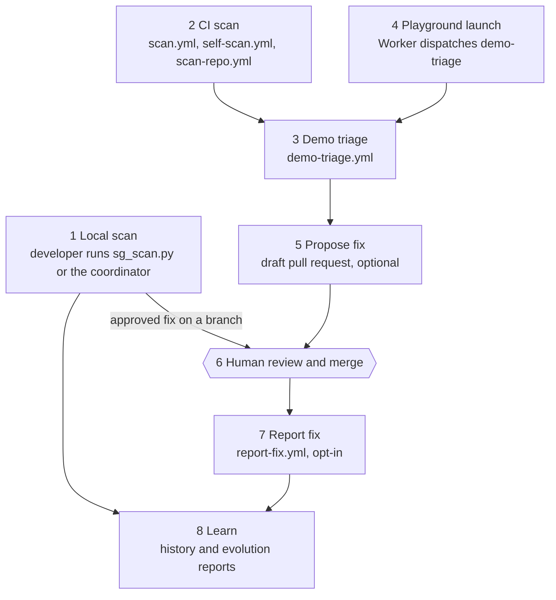

# Flow

This page follows one finding from a scan to a merged fix. Each stage lists who triggers it, the token or credentials it has, and what it produces. For anything marked "never run live", see [Status](status.md).



## 1 Local Scan

**Trigger.** A developer.

```bash
python3 scanner/sg_scan.py demo/vulnerable-ai-app            # exit 0, 1 or 2
python3 scanner/sg_scan.py . --out-dir out --fail-on high    # also writes the three files
kiro-cli chat --agent supplaiguard-coordinator "Run a full SupplAIGuard scan."
```

**Credentials.** None for the scanner. The only network call is to `api.osv.dev`, and only package names and versions are sent. The coordinator needs a Kiro login.

**Coordinator run.** The coordinator delegates in order:

1. **Discover.** The discovery agent inventories dependencies, MCP configs and agent definitions (read-only).
2. **Analyze.** The threat-analysis agent runs the scanner, applies the rule catalog and judges the `SKL-*` findings that need context. It reports attack paths that combine findings.
3. **Remediate.** The remediation agent proposes fixes. It checks the working tree is clean, works on `supplaiguard/fix-<scan_id>`, and every write, `npm install`, commit, push and `gh pr create` asks first. High-impact changes (major bumps, MCP command changes, permission changes) need explicit approval. Merging and force pushes are denied.
4. **Verify.** The verification agent re-runs the scanner. A finding is resolved only if it is no longer reported, and the result is PASS, FAIL or NEEDS_REVIEW.
5. **Learn.** See [Learn](#learn).

**Hooks.** Saving a manifest or agent config triggers analysis. A write triggers verification. Task end triggers the reviewer agent after a prompt.

**Outputs.** JSON or text on stdout, optionally `findings.json`, `summary.md` and `report.html` in `--out-dir`, and, if you approve, a fix branch and pull request.

**Status.** The scanner, the agent permissions and the install script are tested. The full interactive coordinator run, the write approval prompt, verification honesty and the `Stop` hook review were never exercised live (tasks 13.3, 13.4, 13.7, 19.2 and 33.5 in `.kiro/specs/supplaiguard/tasks.md`).

## 2 CI Scan

Three workflows run the same scanner with no secrets.

| Workflow | Trigger | Permissions | What it does |
|---|---|---|---|
| `self-scan.yml` | push to `main`, any pull request from this repository, manual | `contents: read` | Calls `scan.yml` on `.kiro` with `fail-on: low`. Suppressions come from the `.supplaiguard/suppressions.json` on the PR base commit. |
| `scan.yml` (from a consumer) | `workflow_call` | `contents: read` | Validates inputs, downloads the pinned scanner by full commit SHA, scans, writes the job summary, uploads the `supplaiguard-report` artifact (14 days) and gates on the exit code. |
| `scan-repo.yml` | manual (`repo`, `ref`) or the Playground Worker (adds `launch_id`, run name `Scan repo <launch_id>`) | `contents: read` | Clones a public GitHub repository through the hardened fetcher, scans it, publishes a summary and the same artifact. Findings only warn. A scan error fails the job. |

**Gate (`scan.yml`).** Exit 0 passes. Exit 1 fails the check. Exit 2, or a missing `summary.md`, fails the check as "not clean".

**Experimental agent triage.** `scan.yml` has an `agent-triage` job that is off by default. It needs `KIRO_API_KEY`, skips forks, and runs Kiro in an empty directory with read-only tools and deny rules. Only manual `self-scan.yml` runs with `agent-triage: true` pass the key. It ran live twice (task 20.6a), and its output has had little review.

## 3 Demo Triage

**Trigger.** Manual, or the Playground Worker. Inputs: `demo` (`all`, or one of the four demos; `all` covers the first three), `launch_id`, `propose-fix`.

**Jobs.**

| Job | Permissions | What it does |
|---|---|---|
| `matrix` | none | Turns the `demo` input into a list. |
| `triage` (one per demo) | `contents: read` | Scans the untouched demo, uploads `demo-triage-<demo>`. If `KIRO_API_KEY` exists, also copies the demo, renames every `mcp.json` to `mcp.json.disabled`, wraps the findings with `wrap_untrusted` into `findings.untrusted.txt`, and runs the threat-analysis agent headless with read-only tools and deny rules. |
| `propose-fix` | `contents: write`, `pull-requests: write` | Only if `propose-fix` is true. See [Propose Fix](#5-propose-fix-and-draft-pull-request). |
| `publish` | `contents: read`, `actions: read` | Builds the homepage and latest run results with `scanner/build_site.py`, builds the Playground, uploads the Pages artifact. |
| `deploy` (Deploy Results) | `pages: write`, `id-token: write` | Deploys to GitHub Pages. |

**Artifacts.** `demo-triage-<demo>` holds `findings.json`, `report/report.html`, `report/summary.md`, `triage.txt`, `triage.err`, `triage.exit` and `mcp-disabled.txt`. The run page also shows the findings table in the job summary.

Without `KIRO_API_KEY` the deterministic scan still runs, the agent step is skipped, and the page says so.

## 4 Playground Launch

**Trigger.** A visitor on the Playground page.

1. The browser sends `POST /api/launch` with `{ "demoId": "..." }`, and optionally `"proposeFix": true`. The body is parsed strictly and unknown fields get a 400.
2. The Worker checks the kill switch (`LAUNCH_ENABLED`), CORS and the Durable Object limits: one active launch, 3 per client per hour, 30 per UTC day.
3. It asks GitHub for a short-lived installation token for the GitHub App (permissions `actions: write` and metadata read, this repository only) and dispatches `demo-triage.yml` on `main` with `demo` and a `launch_id`. The `propose-fix` input is sent only if the visitor asked and `PROPOSE_FIX_ENABLED` is exactly `"true"`.
4. The page polls `GET /api/status/:id`. The Worker lists recent runs and matches the `launch_id` in the `run-name`.
5. When the run completes, `GET /api/results/:id` returns an allow-listed, size-limited view of the artifact. Agent text is untrusted and shown as plain text.

**Scan by URL (flag `SCAN_URL_ENABLED`, off by default).** When on, the card sends `{ "repoUrl": "...", "ref": "..." }` instead of a demo. The Worker validates the reference in TypeScript (a port of `parse_github_ref` and the guard), keeps only the normalized `owner/repo` and ref, applies tighter limits (1 per client per day, 5 per day) and dispatches `scan-repo.yml` with `repo`, `ref` and `launch_id`. With the flag off the request gets a 403. The results page shows the repository, counts by severity, the exit code meaning and a link to the run, and never shows text from the scanned repository. A failed fetch, a limit or a missing report is shown as incomplete, never clean. URL scans are deterministic only: no agent or model runs on a scanned repository, because it is untrusted and the triage agent needs a secret. Agent triage is available on the four demos. The workflow `scan-repo.yml` ran live once by manual dispatch (run 45071479996: deterministic scan, summary and artifact steps succeeded). The Playground-triggered path has not run live: only fixtures and unit tests cover the Worker dispatch, run lookup, artifact download and results shaping. See [`playground/README.md`](../playground/README.md).

**Private demo (variable `PRIVATE_DEMO_REPO`, empty by default).** The fourth card sends `{ "demoId": "ledgerlight" }`. When the Worker is not connected to a private repository the launch gets a 503 and nothing is reserved. When it is, the Worker applies the normal limits plus its own (2 per client per day, 6 per day), asks GitHub for a token scoped to that one repository, dispatches that repository's workflow with only `launch_id`, finds the run by its `run-name`, and later reads the `supplaiguard-report` artifact. The results page shows counts, rule ids, severities and finding types only. A run that fails its gate with a valid report is a finished scan with findings; a missing report is incomplete. It is private so a triage agent cannot read answers: the code is in the private repository and the answers are outside any repository. The `agent-triage` job of the reusable workflow sees only the report, not the source. Not run live. See [`playground/README.md`](../playground/README.md).

**Outputs.** The same artifacts as [Demo Triage](#3-demo-triage). The Playground never claims a finished triage is a remediation.

**Status.** The Worker code and its tests exist (`playground/worker/test`). The repository does not show whether a Worker is deployed. A live end to end launch is not recorded in the specs, so treat it as never run live from the repository's evidence.

## 5 Propose Fix and Draft Pull Request

**Trigger.** The `propose-fix` workflow input (default false), set by hand or by a Playground launch when the Worker allows it. Experimental and never run live.

**Credentials.** `KIRO_API_KEY` for the agent. A `GITHUB_TOKEN` with `contents: write` and `pull-requests: write`, passed only to the push step and to `gh pr create`, never to the agent. The repository setting **Allow GitHub Actions to create and approve pull requests** must be on.

**Steps.**

1. Scan the demo and keep `before.json`.
2. Make a pristine copy and a working copy, with MCP configs disabled in the working copy and the findings wrapped as untrusted text.
3. Run the remediation agent headless, with deny rules for secrets, `.github`, `.git` and `src`, and told to edit only manifests and agent, skill and MCP config. It must list anything needing a major bump or code change as `NEEDS HUMAN:`.
4. `scanner/fix_gate.py` compares the copies. Any disallowed change fails the job and nothing is proposed. No change means no PR.
5. Apply the allowed files to the checkout. If `package.json` changed, regenerate the lockfile with `npm install --package-lock-only --ignore-scripts`.
6. Scan again and build the before and after report with `scanner/evolution_report.py`.
7. Push the branch `supplaiguard/fix-<run id>-<demo>` and open a **draft** pull request. The body lists the scanner re-check, the changed files, high-impact changes needing explicit approval, and the agent summary as code text. It states that tests were not run.

**Outputs.** The `propose-fix-<demo>` artifact (`gate.json`, `report.json`, `fix.txt`, `pr-url.txt`) and the draft PR. A `GITHUB_TOKEN` pull request does not start other workflows, so close and reopen the draft to run checks on it.

## 6 Human Review and Merge

A person reads the draft, runs the tests, and decides. Nothing in this repository merges a pull request. The agents deny `git merge` and `gh pr merge`, and the workflows have no merge step. A finding is resolved only when a verification re-scan no longer reports it, not when a file changes.

## 7 Report Fix

**Trigger.** `pull_request: closed` in a consumer repository, through `examples/consumer-report-fix.yml`, which calls `report-fix.yml`. Opt-in only.

**Conditions.** `opt-in` is true (the example reads the repository variable `SG_EVOLUTION_OPT_IN`), the PR was merged, it came from a `supplaiguard/fix-*` branch in the same repository, and at least one reviewer approved.

**Steps.**

1. Check out the merge commit. Scan `HEAD^1` (before) and the merge commit (after) with the pinned scanner.
2. Build the sanitized report with `evolution_report.py`. It contains rule ids, severities, counts, outcome, scanner version and date, and nothing else. Outcome `fixed` needs a complete after scan.
3. If the outcome is `fixed`, create a GitHub App token limited to the SupplAIGuard repository (`contents: write`, `pull-requests: write`) and open a pull request there adding `evolution/reports/<run>-<attempt>.json`.

**Credentials.** `contents: read` and `pull-requests: read` for the consumer job. The secrets `SG_APP_ID` and `SG_APP_PRIVATE_KEY` for the upstream pull request.

**Status.** Written and tested at the unit level. It has never run live, and its expression was just fixed to remove an invalid `split()` call (commit `32c4160`). A test now lints every workflow expression.

## Learn

**Local history.** Each scan by the threat-analysis and verification agents, or by you with `--history`, appends one line to `.supplaiguard/history.jsonl` in the scanned repository: date, scanner version, branch, commit, whether the scan was complete, and for each finding only its type, rule, component, severity and a status (`new`, `remaining` or `recurred`). It stores no evidence, paths or file contents. `--learn-report` shows which findings came back, which stayed open across three runs and which rules fire most. Incomplete scans never count as fixes. Learn is advisory and never changes findings or exit codes.

**Evolution.** The report PRs from step 7 are the intended input for rule changes. Nothing yet turns those reports into rule or skill changes (R17.2, R17.5), and the Kiro Crew steward is planned with no code. No `evolution/` directory exists yet.

Next: [Security Model](security-model.md).
